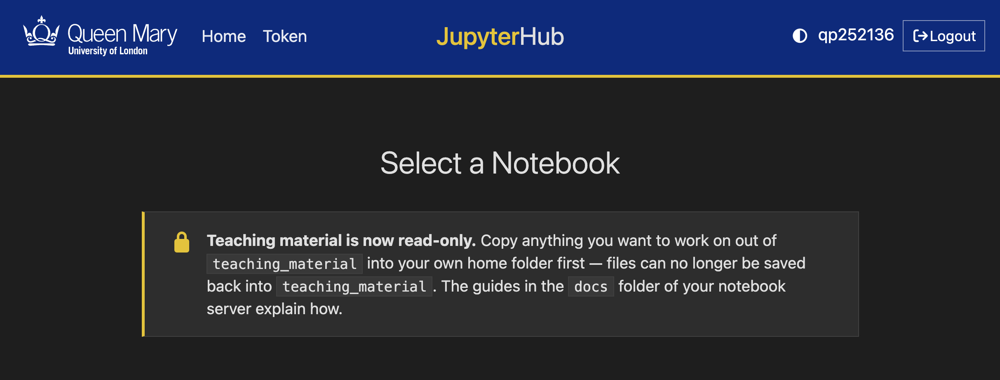
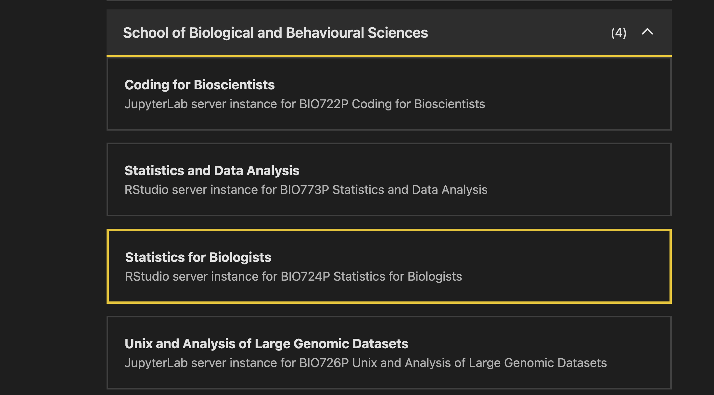
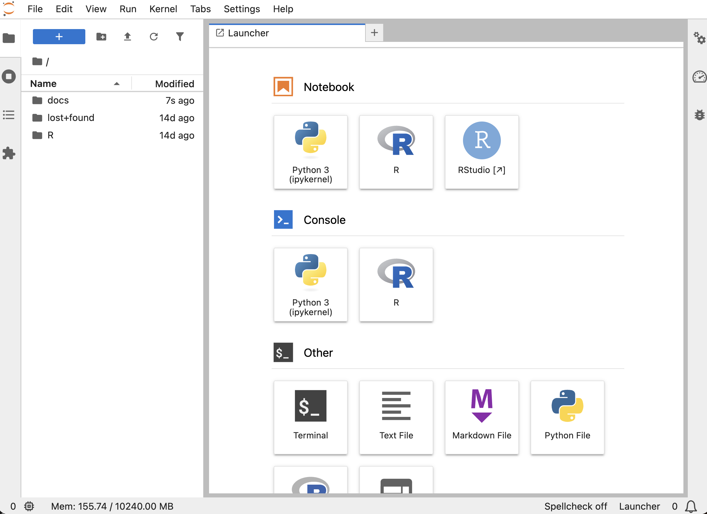
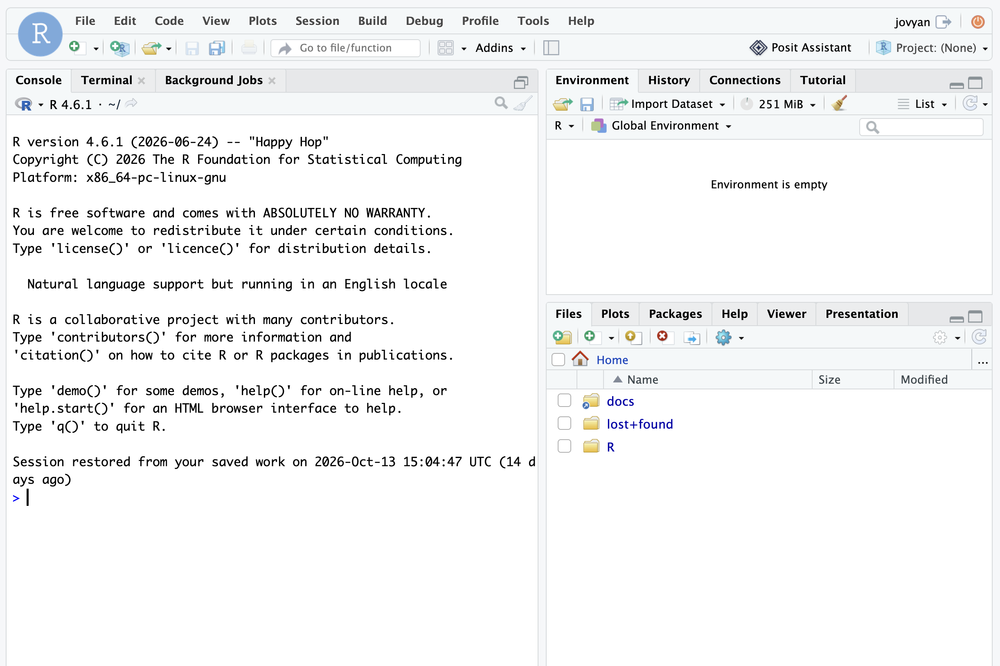

# **Rstudio on the Teaching Cluster** 

Please follow the steps outlined below to access and use RStudio via the Queen Mary Teaching Cluster. This resource you should be familiar with from BIO726P & BIO722P. 

---------------------

## **Step 1: Head to the QMUL Teaching Cluster**

Head over to the Teaching Cluster Hub [https://hub.comp-teach.qmul.ac.uk/](https://hub.comp-teach.qmul.ac.uk/)

---------

## **Step 2: Select Your WorkSpace - BIO724P** 

Scroll down to the **School of Biological and Behavioural Sciences** option, and select the option **Statistics for Biologists - BIO724P**. Once selected scroll down and press **Start** to launch your workspace! *(This may take 1-2 minutes)*

---------

## **Setp 3: Select the RStudio tile** 

Once your juypter workspace has been launched, your have several options! You can select to work in the terminal or R Console. However, we recommend using **RStudio!**  

You are now ready to complete the crash course in R! 

